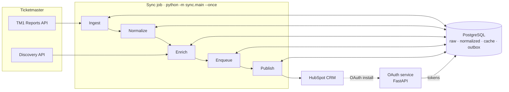
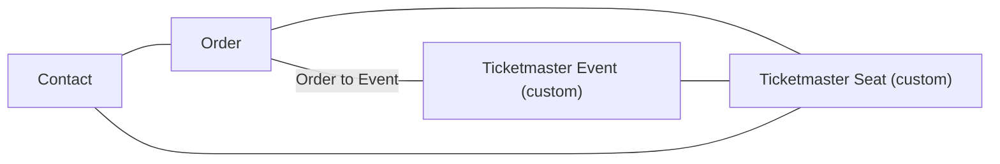
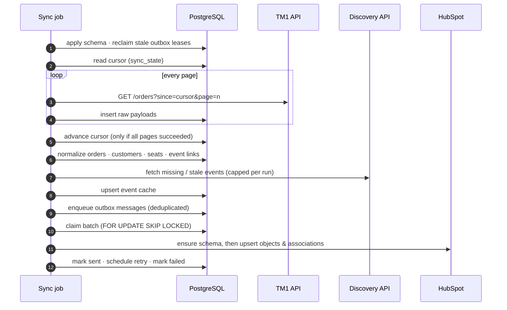
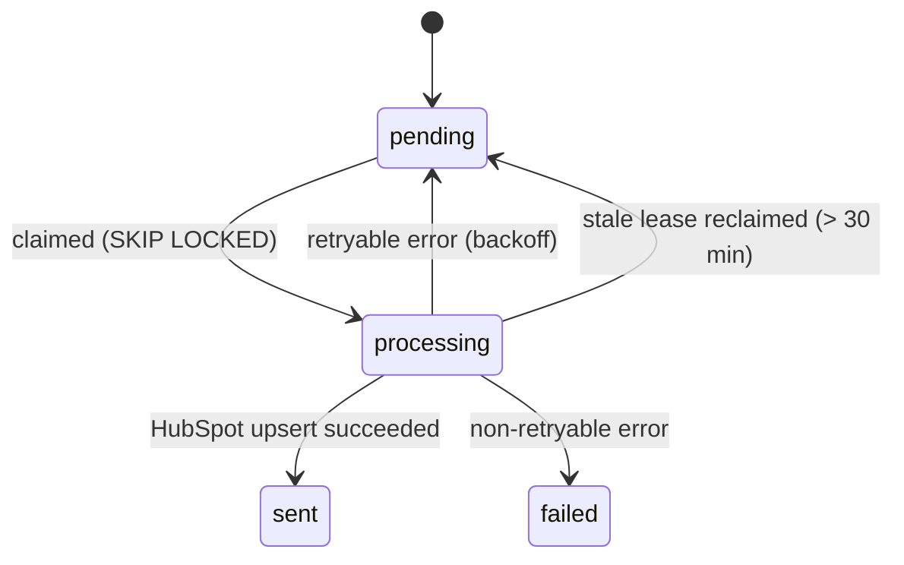

# TM1 → HubSpot Sync

> An API-driven data integration that synchronizes Ticketmaster TM1 orders, customers,
> events and seats into HubSpot CRM. It replaces a legacy SFTP batch export with an
> incremental pipeline built on PostgreSQL and an outbox delivery queue.


---

## Overview

I designed, built and deployed this service as a production integration for a client in
the live-events industry. Their ticket-buyer data lived in Ticketmaster's **TM1** platform
and reached their CRM through scheduled **SFTP file exports**. That process was slow and
hard to audit, and it could only carry flat contact data.

This service replaces that flow with an API-to-API pipeline. It:

- pulls **only what changed** from the TM1 Reports API, using a persisted cursor;
- enriches orders with event metadata from the **Ticketmaster Discovery API**;
- models the data in HubSpot as **Contacts, Orders and two custom objects (Events and Seats)**,
  linked by **labeled associations**;
- delivers every change through a **PostgreSQL-backed outbox queue** with retry
  classification, exponential backoff and idempotent upserts.

> **About this repository.** This is a sanitized portfolio edition of the original work.
> It contains no client names, credentials, infrastructure identifiers or customer data.
> It is published for viewing only: see [License](#license).

---

## Architecture



| Component | Path | Role |
|---|---|---|
| **Sync job** | [`tm1-sync/sync`](tm1-sync/sync), [`tm1-sync/db`](tm1-sync/db) | Batch worker. Runs the five-stage pipeline once per invocation (`--once`, for an external scheduler) or in a loop. |
| **OAuth service** | [`tm1-sync/oauth`](tm1-sync/oauth) | FastAPI app that completes HubSpot's OAuth install flow and stores the tokens. |
| **HubSpot app definition** | [`TM1_Hubspot_data_sync`](TM1_Hubspot_data_sync) | HubSpot Developer Project that declares the OAuth app, its scopes and its redirect URL. |
| **Export tool** | [`tools`](tools) | Stand-alone CLI that exports buyers of past events to CSV. |

---

## Features

### Synchronization
- **Incremental ingestion.** Each tenant has a cursor (`sync_state`) that advances only after every page of a run has been fetched successfully.
- **Raw audit layer.** Unmodified API payloads are stored, so data can be replayed and normalized again.
- **Normalization** into orders, customers, seats and order→event links. Customers flagged `piiCleared` by TM1, or without an email, are never synced.
- **Event enrichment cache.** Events are refreshed based on a TTL and on missing fields, prioritized, and capped per run to stay within the Discovery API's daily quota.

### Reliable delivery
- **Outbox queue** with nine message types (objects and associations). Dedupe keys are enforced by a partial unique index while messages are in flight.
- **Concurrency-safe batch claiming** with `SELECT … FOR UPDATE SKIP LOCKED`.
- **Retry classification.** 429, 5xx and network errors are retryable; other 4xx responses are terminal. Retries use exponential backoff with jitter (10 s → 30 min) and honor `Retry-After`.
- **Stale-lease recovery.** Messages stuck in `processing` are automatically returned to the queue.
- **Idempotent upserts** keyed on external IDs (`tm1_unique_id`, `tm_event_id`, `seat_unique_id`, email), so retries update existing records.

### HubSpot
- **Self-provisioning schema.** At runtime the job creates whatever is missing: the *Ticketmaster Event* and *Ticketmaster Seat* custom objects, about 60 custom properties, property groups and labeled association types.
- **OAuth 2.0.** Authorization-code install flow, automatic access-token refresh and refresh-token persistence.
- **Client-side rate limiting** with a token bucket.
- **Derived business fields.** Order display names, localized event names, Matinee/Evening classification by local start time, and readable seat labels.

### Operations
- **Structured JSON logs** with a per-run correlation ID, per-stage timings, queue-depth snapshots and sampled per-item tracing.
- **PII-aware logging.** Emails are hashed in item traces and HTTP bodies are truncated.
- **Multi-tenant data model.** Every table carries a `client_id`.

---

## HubSpot data model



---

## How a sync run works



HubSpot writes happen in dependency order:
contacts → orders → order↔contact → events → order↔event → seats → order↔seat → event↔seat → contact↔seat.

---

## Database and the outbox

| Table | Purpose |
|---|---|
| `sync_state` | Incremental cursor per tenant and entity |
| `tm1_orders_raw` | Raw API payloads, kept for audit and replay |
| `tm1_orders`, `tm1_customers`, `tm1_seats`, `tm_order_events` | Normalized current state |
| `tm_events` | Discovery API cache |
| `hubspot_outbox` | Delivery queue: `status`, `attempts`, `next_retry_at`, `last_error`, `hubspot_object_id` |
| `oauth_tokens`, `hubspot_meta` | OAuth tokens and discovered HubSpot identifiers, per portal |

The schema lives in [`tm1-sync/db/sql/schema.sql`](tm1-sync/db/sql/schema.sql). It is idempotent and is applied at the start of every run.

Outbox message lifecycle:



Delivery is **at-least-once**. Consumers upsert by external ID, so a message that is redelivered updates the existing record.

---

## Tech stack

**Python 3.12** · **PostgreSQL** (jsonb, citext, enums, partial indexes, `SKIP LOCKED`) · psycopg2 · requests ·
**FastAPI** / Uvicorn · **Docker** · HubSpot CRM v3/v4 and OAuth v3 APIs · Ticketmaster TM1 Reports and Discovery APIs

---

## Project structure

```
.
├── tm1-sync/
│   ├── sync/            # pipeline stages, API clients, publisher, HubSpot provisioning, logging
│   ├── db/              # connection, schema.sql, repositories, locks
│   ├── oauth/           # FastAPI OAuth callback service
│   └── shared/          # legacy helpers (scheduled for removal)
├── TM1_Hubspot_data_sync/   # HubSpot Developer Project (app, scopes, redirect URL)
├── tools/               # fetch_past_buyers.py: past-event buyers → CSV
└── docs/                # architecture decision records
```

---

## Getting started

### Prerequisites
- Python 3.12+
- PostgreSQL 14+ with the `citext` extension available
- Docker (optional)
- A HubSpot developer account and the HubSpot CLI, to deploy the app in `TM1_Hubspot_data_sync/`
- Ticketmaster TM1 Reports API and Discovery API keys

### 1. Configure
```bash
cd tm1-sync
cp sync/.env.example sync/.env     # sync job settings
cp oauth/.env.example oauth/.env   # OAuth service settings
# Edit both files and replace every <placeholder>.
```
See [`tm1-sync/sync/.env.example`](tm1-sync/sync/.env.example) for every setting, with defaults and descriptions.

### 2. Install dependencies
```bash
python -m venv .venv
source .venv/bin/activate          # Windows: .venv\Scripts\Activate.ps1
pip install -r sync/requirements.txt -r oauth/requirements.txt
```

### 3. Deploy the HubSpot app and authorize it
1. In `TM1_Hubspot_data_sync/src/app/app-hsmeta.json`, set `redirectUrls` to your OAuth service URL.
2. Upload the project with the HubSpot CLI: `hs project upload`, run from `TM1_Hubspot_data_sync/`.
3. Start the OAuth service:
   ```bash
   cd oauth && uvicorn main:app --port 8080
   ```
4. Install the app in your HubSpot portal. The callback stores the tokens in `oauth_tokens`.

### 4. Run a sync
```bash
cd tm1-sync
python -m sync.main --once         # one iteration (for cron / scheduled jobs)
python -m sync.main                # continuous loop, sleeping SLEEP_SECONDS between runs
```
The database schema is created or updated automatically at the start of each run.
The publish stage needs an `oauth_tokens` row for `HUBSPOT_PORTAL_ID`, which step 3 creates.

### Docker
```bash
# Sync job (the build context is tm1-sync/)
cd tm1-sync
docker build -f sync/Dockerfile -t tm1-sync-job .
docker run --rm --env-file sync/.env tm1-sync-job

# OAuth service
cd oauth
docker build -t tm1-oauth .
docker run --rm -p 8080:8080 --env-file .env tm1-oauth
```
In production, the sync image is run on a schedule (for example every 15 minutes) by the hosting platform's job scheduler. The OAuth image runs as a small web service.

---

## API integrations

| API | Authentication | Used for |
|---|---|---|
| TM1 Reports API v1 | API key | `GET /orders` with an incremental `since` cursor and pagination |
| Ticketmaster Discovery API v2 | API key | `GET /events/{id}` for event, venue, attraction and sales metadata |
| HubSpot OAuth v3 | Client ID/secret | Authorization-code exchange and token refresh |
| HubSpot CRM v3 | Bearer token | Object search, create and update; properties and groups; custom object schemas |
| HubSpot CRM v4 | Bearer token | Association labels; labeled association create, list and archive |

---

## Testing

There is no automated test suite yet. It is the next milestone on the roadmap. The core
transformation logic was written as pure functions with test coverage in mind: seat and
event extraction, HubSpot property mappers, retry classification, backoff and the rate
limiter.

---

## Security and privacy

- No credentials in source control. All secrets come from environment variables, and only placeholder `.env.example` templates are tracked.
- `.gitignore` and `.dockerignore` exclude secrets, local state and data exports from commits and container images.
- OAuth tokens are stored server-side and refreshed automatically.
- Customers flagged `piiCleared` by TM1 are never synced. Item-level logs hash email addresses, and HTTP error bodies are truncated.
- The export tool produces personal data. Write its output outside the repository and handle it under your data-protection obligations.

---

## Roadmap

The following hardening work is **planned and not yet implemented**:

- [ ] Hold the per-tenant advisory lock for the full run, so overlapping runs are rejected
- [ ] Transactional outbox: write normalized state and outbox messages in a single transaction
- [ ] Maximum delivery attempts with a dead-letter state and alerting
- [ ] Persist the discovered HubSpot metadata cache across runs
- [ ] Remove the remaining raw identifiers from logs; validate OAuth `state`
- [ ] Unit and integration test suite (pytest, PostgreSQL service container)
- [ ] CI: lint (Ruff), tests, image builds, secret scanning, dependency audit
- [ ] `docker-compose` development environment with mocked external APIs
- [ ] HubSpot batch upsert endpoints; connection pooling; versioned migrations

---

## License

**All Rights Reserved.** The source is publicly visible for portfolio review only. No permission
is granted to use, copy, modify or distribute it. See [`LICENSE`](LICENSE).

Ticketmaster, TM1 and HubSpot are trademarks of their respective owners. This project is not
affiliated with or endorsed by them.
